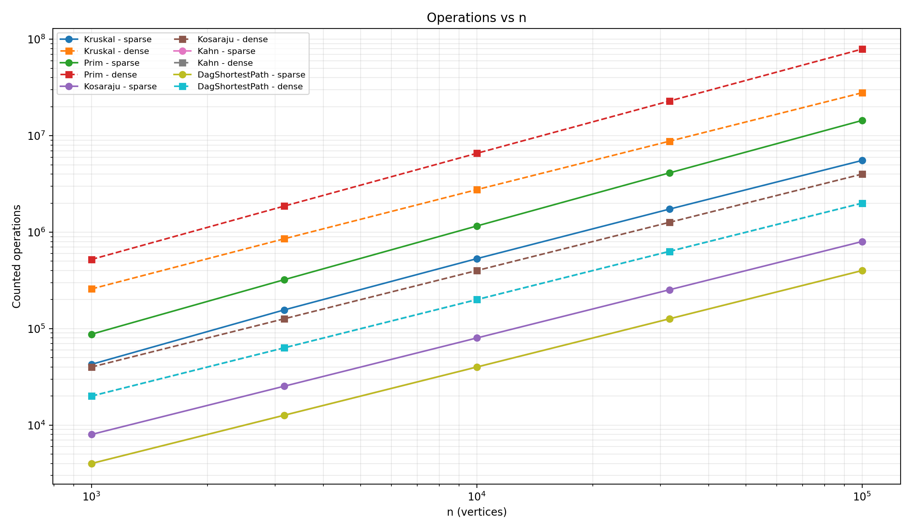
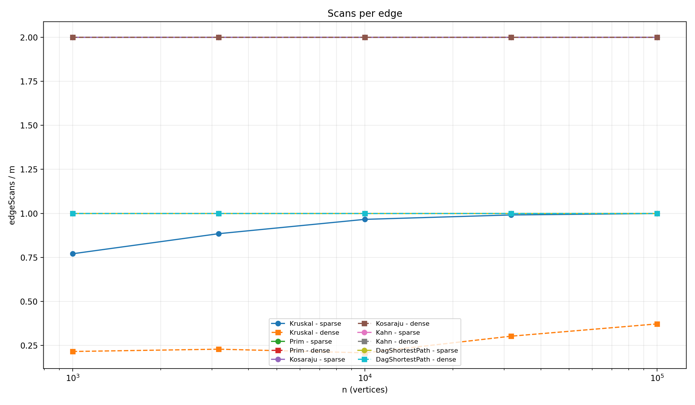
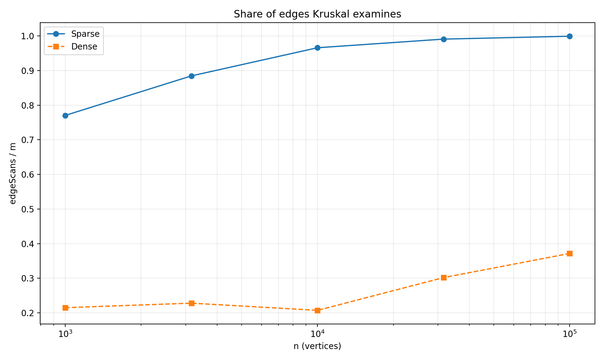

# Assignment 3 - Graphs: DSU, MST, SCC and Shortest Paths

## Introduction

In this assignment, I implemented several graph algorithms for different problems. The project includes Disjoint Set Union, Kruskal, Prim, Kosaraju, Kahn's algorithm and shortest paths in a DAG.

The graph is stored using an adjacency list and supports both directed and undirected graphs. All algorithms use the same Graph class.

The project also includes operation counters, automatic benchmarks and JUnit tests. The benchmark uses the same random seed, so the results are reproducible.

Kruskal and Prim are used for minimum spanning trees. Kosaraju finds strongly connected components, Kahn creates a topological order and detects cycles, and DAG shortest path calculates shortest distances in a directed acyclic graph.

## Complexity Table

| Algorithm | Time Complexity | Extra Space | Explanation |
|---|---|---|---|
| DSU find / union | O(α(V)) amortized | O(V) | Path compression and union by rank make DSU operations almost constant time. |
| Kruskal | O(E log E) | O(V + E) | The main cost is sorting all edges by weight. DSU is used to detect cycles. |
| Prim | O(E log E) | O(V + E) | A priority queue is used to repeatedly select the smallest available edge. |
| Kosaraju | O(V + E) | O(V + E) | The graph is traversed twice and a reversed graph is created. |
| Kahn | O(V + E) | O(V) | Every vertex enters the queue once and every edge is scanned once. |
| DAG Shortest Path | O(V + E) | O(V) | Vertices are processed in topological order and every edge is relaxed once. |

## Counters vs Formulas

The operation counters confirm the expected complexity of the algorithms. Unlike execution time, these counters do not depend on the computer or JVM performance.

For Prim, every undirected edge is stored in both directions in the adjacency list. Because of this, the algorithm scans exactly `2E` adjacency edges. For example, with `n = 100000` and `m = 400000`, Prim performs 800000 edge scans. The ratio `edgeScans / E` is therefore always 2.

Kosaraju performs two graph traversals. On sparse graphs, where `E = 4V`, its ratio is:

`edgeScans / (V + E) = 2E / (V + E) = 1.60`

On dense graphs, where `E = 20V`, the ratio is approximately 1.90. These values stay constant when the graph size increases.

Kahn's algorithm scans every directed edge exactly once. Therefore:

`edgeScans / E = 1`

The same result is obtained for the relaxation stage of DAG Shortest Path:

`edgeScans / E = 1`

Kruskal has a larger amount of work because it must first sort the edges. Its comparison counter grows slightly faster than the linear traversal algorithms, which agrees with the expected `O(E log E)` complexity. Its DSU operations also grow with the number of examined edges, while path compression and union by rank keep each DSU operation very cheap.

| Algorithm | Counter Check | Result |
|---|---|---|
| Prim | edgeScans / E | 2.00 |
| Kosaraju sparse | edgeScans / (V + E) | 1.60 |
| Kosaraju dense | edgeScans / (V + E) | about 1.90 |
| Kahn | edgeScans / E | 1.00 |
| DAG Shortest Path | edgeScans / E | 1.00 |
| Kruskal | comparisons compared with E log E | Same growth class |

## Correctness Arguments

### Cut Property

The cut property says that the lightest edge crossing a cut can safely be included in a minimum spanning tree. Kruskal uses this idea by processing edges from the smallest weight to the largest. If an edge connects two different DSU components, it is safe to add because it connects two separate parts of the tree without creating a cycle. Prim also uses the cut property, but it grows one tree from a starting vertex. At every step, it selects the lightest edge that connects the current tree with a vertex outside the tree. Because both algorithms always choose safe edges, they produce a minimum spanning tree with the same total weight.

### Induction on Topological Order

In a DAG, every edge goes forward in a valid topological order. All vertices with in-degree 0 start with distance 0, which is equivalent to using a virtual super-source. When a vertex is processed, all vertices that can come before it have already been processed. Therefore, its shortest distance is already final when its outgoing edges are relaxed. By induction, after processing each next vertex in topological order, its outgoing edges correctly update the shortest distances of later vertices. This means that one pass over the edges is enough to find all shortest paths in `O(V + E)`. Negative edge weights are safe because a DAG has no cycles, so there cannot be a negative cycle that repeatedly decreases the distance.

## Which Algorithm When

| Situation | Algorithm | Why |
|---|---|---|
| Minimum spanning tree, edge list available | Kruskal | It works naturally with an edge list because it sorts all edges by weight and uses DSU to avoid cycles. |
| Minimum spanning tree, adjacency list available | Prim | It grows the tree directly from adjacent edges and uses a priority queue. |
| Sparse graph for MST | Kruskal | Sorting a relatively small number of edges is efficient, and DSU operations are very cheap. |
| Dense graph for MST | Prim | Prim can work well with adjacency lists and does not need to sort the complete edge list first. |
| Need strongly connected components | Kosaraju | It finds all SCCs in `O(V + E)` using two graph traversals. |
| Need dependency order and graph must be a DAG | Kahn | It creates a topological order using in-degrees and a queue. |
| Need to detect a cycle in a directed graph | Kahn | If fewer than `V` vertices are processed, a cycle exists. |
| Need shortest paths in a DAG | DAG Shortest Path | Topological order allows every edge to be relaxed once in `O(V + E)`. |
| Negative edge weights but graph is a DAG | DAG Shortest Path | Negative weights are safe because a DAG cannot contain a negative cycle. |
| General graph with possible cycles for shortest paths | Not DAG Shortest Path | This algorithm requires a DAG, so another shortest-path algorithm must be used. |

## Slope Check

On log-log axes, a slope close to 1 means that the number of operations grows approximately linearly with the graph size.

The measured edge-scan slopes for Prim, Kosaraju, Kahn and DAG Shortest Path are approximately `1.00`. This agrees with their expected linear traversal behavior when the graph density is fixed.

For Kruskal, the measured slope is approximately `1.06` on sparse graphs and `1.12` on dense graphs. This is slightly steeper than the traversal algorithms. Kruskal also has to sort the edges, so its total amount of work grows according to `O(E log E)` rather than pure linear growth.

These results support the theoretical complexity analysis.

## Plots

### Operations vs n

The graph shows how the measured operation counts increase as `n` grows. Linear traversal algorithms grow regularly, while Kruskal shows slightly steeper growth.

### Scans per Edge

Kahn and DAG Shortest Path stay at approximately `1` scan per edge. Kosaraju and Prim stay at approximately `2` because every edge is examined twice in their measured traversal representation.

### Share of Edges Examined by Kruskal

On sparse graphs, Kruskal eventually examines almost all edges before the MST is complete. On dense graphs, it can finish after examining a much smaller fraction of all available edges.

## Measured Time

The measured execution times increased as the graphs became larger and denser. On the largest dense graph with `n = 100000` and `m = 2000000`, Kruskal took about `413.5 ms`, Prim about `1128.5 ms`, Kosaraju about `281.6 ms`, Kahn about `57.2 ms`, and DAG Shortest Path about `102.4 ms`. In this benchmark, Kahn and DAG Shortest Path were especially fast because they process the graph in linear time. However, execution time is not the main evidence for complexity because it depends on the computer, JVM version and background processes. For this reason, the conclusions of this report are mainly based on operation counters.

## Conclusion

In this assignment, I implemented and tested DSU, Kruskal, Prim, Kosaraju, Kahn and DAG Shortest Path. Kruskal and Prim produced the same MST weights for all generated graphs. Kosaraju correctly found strongly connected components without using recursive DFS, and Kahn correctly detected cycles and generated topological orders. DAG Shortest Path worked with both positive and negative edge weights because the graph contains no cycles. The benchmark results matched all reference values, and the operation counters supported the expected complexity formulas. The tests and benchmark showed that the implementations are correct, reproducible and safe for graphs with up to 100000 vertices.